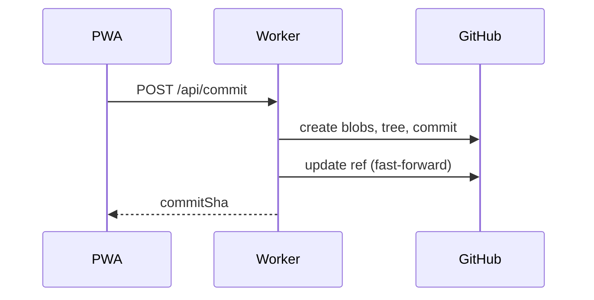

# Sync design

The PWA keeps drafts locally and bundles them into one commit. This [depends on direct commits](/decisions/adr-004-direct-commits.md "rel:depends-on").

## Commit flow

<!--nitrogen:table style=grid caption="Sync states"-->
| State | Meaning |
| --- | --- |
| Synced | Nothing queued |
| Conflict | Needs a merge |

:::drawer{title="Conflict handling" width="lg"}
A stale `baseSha` returns `409` with the remote content. The client runs a 3-way merge.
:::

## Polling

The client polls `/api/changes` every 20 seconds while visible.
