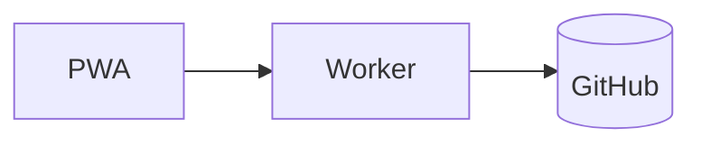

# Nitrogen Flavored Markdown (CFM) v0.1

Status: draft, version `0.1`. This document is the contract. The conformance fixtures in
`packages/spec/fixtures/` are normative examples; when prose and fixtures disagree, open an issue
and fix whichever is wrong.

CFM = CommonMark + GFM (tables, task lists, footnotes, strikethrough, autolinks) + the extensions
below. UTF-8, LF line endings, `.md` extension.

## 5.1 File naming

Lowercase ASCII `[a-z0-9-]`, hyphen separated, `.md`. Folder pages are `index.md`. Lint warns on
spaces, uppercase, underscores. Page titles are not derived from file names unless no title exists.

## 5.2 Frontmatter (strict subset so the Worker can parse it cheaply)

Flat YAML only: scalars, booleans, integers, ISO dates, inline lists `[a, b]`. No nested maps, no
multiline scalars, no anchors.

```yaml
---
title: Sync design           # fallback: first H1, then file name
icon: git-branch             # optional icon name or one glyph
order: 20                    # sibling order, lower first; default alphabetical
tags: [architecture, sync]
status: draft                # draft | active | archived (free text allowed, these are styled)
aliases: [Commit pipeline]   # extra names for wikilink resolution and search
pinned: false                # show in the sidebar Pinned group
locked: false                # MCP write tools must refuse locked pages
updated: 2026-11-02          # tool-maintained; never required
---
```

Grammar (normative):

- The block starts with `---` on line 1 and ends at the next line that is exactly `---`.
- Each non-blank line is `key: value` with an optional trailing ` # comment`. Keys match
  `[A-Za-z_][A-Za-z0-9_-]*`. Lines starting with `#` are comments.
- A value is one of: empty (null), `true`/`false`, an integer, a `YYYY-MM-DD` date, a single- or
  double-quoted string, an inline list `[a, "b, c", d]` of scalars, or a plain string that does not
  start with `{`, `|`, `>`, `&`, `*`, `!`, `-` followed by space, or `[` (unless it is a list).
- Indented lines, `key:` followed by an indented block, block scalars and anchors are E001.
- Duplicate keys are E001.
- Known keys are type checked: `title`, `icon`, `status` strings; `order` integer; `tags`,
  `aliases` lists (a single string is accepted and treated as a one-item list); `pinned`, `locked`
  booleans; `updated` date. Unknown keys are allowed and preserved.

## 5.3 Hierarchy

- Folders are the hierarchy. A folder's page is `index.md` inside it; its `title`, `icon`, `order`
  come from that file. Missing `index.md` -> synthesized folder node (title-cased folder name) with
  an auto-generated "Subpages" list.
- Siblings sort by `order` ascending (pages without `order` after pages with it), then title
  (natural sort, case-insensitive).
- Breadcrumbs derive from the path. Prev/next derive from sibling order.
- Moving a page = `git mv`. The tools rewrite inbound links in the same commit.

## 5.4 Links

**Canonical on disk:** standard markdown links with **root-relative** paths and `.md` extension:

```md
[Sync design](/architecture/sync-design.md)
[Commit flow](/architecture/sync-design.md#commit-flow)
[replaces the old plan](/decisions/adr-002.md "rel:supersedes")
```

- Root-relative paths resolve on GitHub (repo root) and in Nitrogen identically.
- **Typed links** use the link title attribute with a `rel:` prefix. Vocabulary from
  `link_relations`. Untyped links are `related`.
- **Wikilinks are accepted as input only** and rewritten to canonical links by the autofixer on save
  (web and MCP): `[[Sync design]]`, `[[architecture/sync-design]]`,
  `[[Sync design#Commit flow|the flow]]`. Resolution order: exact path, exact title, alias, unique
  basename. Ambiguous or unresolved wikilinks are left intact and linted (rendered as dashed "create
  page" links in the UI). Title and alias matching is case-insensitive.
- Page-relative links (`../x.md`, `x.md`) are accepted and resolved against the containing page; the
  autofixer does not rewrite them (they are valid markdown), but tools always write root-relative.
- External links are plain markdown links; render with an external-link indicator,
  `rel="noopener noreferrer"`, `target="_blank"`.
- Heading anchors use GitHub's slug algorithm (so anchors work on github.com too).
- Links inside code spans and code blocks are not links.

## 5.5 Callouts

Obsidian/GFM-compatible blockquote syntax:

```md
> [!warning]+ Optional title
> Body with **markdown**, lists, code.
```

- Native GFM alert types (render natively on GitHub): `note`, `tip`, `important`, `warning`,
  `caution`.
- Extended types (render as a plain blockquote on GitHub): `info`, `question`, `success`, `danger`,
  `example`, `quote`, `decision`, `assumption`.
- Fold marker after the type: `+` expanded-collapsible, `-` collapsed-collapsible, none = static.
- Types are case-insensitive; unknown types lint as errors with a suggestion.
- The marker must be the first thing in the first line of the blockquote.

## 5.6 Toggles

Native HTML details, which GitHub renders. Blank lines around the body are required so markdown
inside parses.

```md
<details>
<summary>Why not branches?</summary>

Markdown body here. **Formatting** works.

</details>
```

`open` attribute = expanded by default. Toggles may nest and may contain any block. The sanitizer
allows only `details` and `summary` from raw HTML (plus `br`, `kbd`, `sub`, `sup`).

## 5.7 Drawers

A drawer is supplementary content that opens in a side panel (bottom sheet on mobile) instead of
expanding inline. Container directive syntax (remark-directive compatible):

```md
:::drawer{title="Field reference" icon="table"}
Markdown body. Tables, images, mermaid, lists all allowed.
:::
```

- Renders in the page as a compact labeled button at the place it appears.
- Attributes: `title` (required), `icon` (optional), `width` (`sm|md|lg`, default `md`).
- Top level, inside a callout, or inside a toggle only. **Drawers cannot nest** (lint error). No
  drawers inside list items or tables.
- Raw GitHub shows the `:::` lines literally; that is the accepted degradation, and it is why
  normalization rewrites drawers.
- Other `:::name` container directives are not part of CFM v0.1 and are left as text.

## 5.8 Images

Standard markdown image syntax. Display metadata rides in the **URL fragment** (ignored by every
other renderer), caption in the standard title.

```md

```

Fragment keys (URLSearchParams format, all optional):

| key | values | default |
|---|---|---|
| `align` | `left`, `center`, `right`, `full` | `center` |
| `w` | integer px or percentage (`320`, `60%`) | natural, capped to column |
| `h` | integer px | auto |
| `wrap` | `true`, `false` (text wraps around left/right aligned images) | `true` |
| `zoom` | `true`, `false` (click to enlarge) | `true` |
| `border` | `true`, `false` | `false` |

- Alt text is **required** (lint error if empty).
- Image alone in a paragraph = figure with optional caption. Image inside a sentence = inline, size
  only.
- Path must be root-relative under `assets_dir`, or an absolute `https` URL (external images get an
  "external" badge and are blocked by default CSP unless allowlisted in config; v1: blocked).
- Canonical fragment key order (applied by the autofixer): `align, w, h, wrap, zoom, border`.

## 5.9 Tables

GFM pipe tables. Styling via an HTML comment directive **immediately above** the table (no blank
line):

```md
<!--nitrogen:table style=zebra header=sticky widths=30,20,50 caption="Sync states" dense=false-->
| State | Meaning | Action |
| :--- | :---: | ---: |
| Synced | Up to date | None |
```

Keys: `style` (`plain|zebra|grid`, default `plain`), `header` (`normal|sticky`), `widths` (comma
list summing to 100, one per column), `caption`, `dense` (bool), `wrap` (bool, default true). Column
alignment from the standard `:---:` markers. Cells hold inline markdown and `<br>`. No merged cells
(raw HTML tables are stripped by the sanitizer and linted as E008).

## 5.10 Mermaid

Standard fenced block, which GitHub renders natively:

````md

````

Optional meta after the language in the info string (ignored by GitHub):
```` ```mermaid title="Commit flow" caption="Happy path" ````. Rendered client-side only.

## 5.11 Everything else

Task lists (`- [ ]`), footnotes, code fences with language, `<kbd>`, horizontal rules,
strikethrough. Math (`$$`) and columns are not part of v0.1.

## 5.12 Lint catalog (stable codes)

`E` = error (MCP refuses write unless `force`), `W` = warning (returned with the write result).

| Code | Level | Rule |
|---|---|---|
| E001 | E | Frontmatter invalid or outside the strict subset |
| E002 | E | Unknown callout type |
| E003 | E | Drawer nested, or drawer in a disallowed container |
| E004 | E | Drawer missing `title` |
| E005 | E | Image missing alt text |
| E006 | E | Invalid image fragment key or value |
| E007 | E | Table directive not directly above a table, or `widths` do not sum to 100 |
| E008 | E | Disallowed raw HTML (script, style, iframe, object, on* attributes) |
| E009 | E | Write path outside content root, or into an ignored/reserved folder |
| E010 | E | Page is `locked: true` |
| W101 | W | Broken internal link (target page missing) |
| W102 | W | Broken anchor (heading not found) |
| W103 | W | Broken image path |
| W104 | W | Unresolved or ambiguous wikilink |
| W105 | W | File name not kebab-case |
| W106 | W | Duplicate heading slug in page |
| W107 | W | Unknown link `rel:` value |
| W108 | W | Page larger than `page_size_warn_kb` |
| W109 | W | First heading is not H1, or multiple H1 |
| W110 | W | `toggle` missing blank lines around body |

E009 and E010 are write-time checks (they depend on the path and the stored page) and are reported
by write tools, not by `lintPage` on content alone. E008 also covers raw HTML outside the allowlist
(`details`, `summary`, `br`, `kbd`, `sub`, `sup`, HTML comments).

## Conformance fixtures

Each fixture `name` may have: `name.in.md` (input), `name.diag.json` (expected diagnostic codes and
lines), `name.gfm.md` / `name.cm.md` (expected normalized output), `name.index.json` (expected index
rows). Fixtures run against both the full parser and the light scanner.
