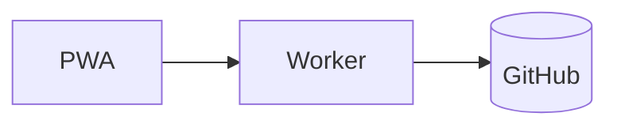

# Format tour

- **Tags:** format, demo
- **Status:** active
- **Aliases:** CFM tour, Format reference

Every Nitrogen construct on one page. See [Sync design](../architecture/sync-design.md#commit-flow "rel:cites")
for a real example.

## Links

A canonical link: [Home](../index.md). A typed link: [the decision](../decisions/adr-004-direct-commits.md "rel:implements").
An external link: [CommonMark](https://commonmark.org).

## Callouts

> **Note**
>
> A native GFM alert.

> **Warning: Foldable warning**
>
> Expanded by default, but it can collapse.

> **Decision: Collapsed decision**
>
> Extended types degrade to a plain blockquote on GitHub.

## Toggle

**Why source editing?**

Because the file is **exactly** what you see in git.

## Drawer

> **Field reference**
>
> | Field | Meaning |
> | --- | --- |
> | `title` | Page title |

## Image

Text wraps around right aligned figures.

## Table

*Sync states*

| State | Meaning | Action |
| :--- | :---: | ---: |
| Synced | Up to date | None |
| Queued | Waiting | Wait |

## Mermaid

## Tasks and footnotes

- [x] Write the spec
- [ ] Ship v0.1[^1]

[^1]: Soon.

Press `Cmd`+`K` to search. ~~Old idea~~.
