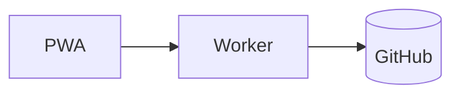

# Format tour

Every Nitrogen construct on one page. See [Sync design](../architecture/sync-design.md#commit-flow "rel:cites")
for a real example.

## Links

A canonical link: [Home](../index.md). A typed link: [the decision](../decisions/adr-004-direct-commits.md "rel:implements").
An external link: [CommonMark](https://commonmark.org).

## Callouts

> [!NOTE]
> A native GFM alert.

> [!WARNING]
> **Foldable warning**
>
> Expanded by default, but it can collapse.

> [!IMPORTANT]
> **Decision: Collapsed decision**
>
> Extended types degrade to a plain blockquote on GitHub.

## Toggle

Why source editing?

Because the file is **exactly** what you see in git.

## Drawer

Field reference

| Field | Meaning |
| --- | --- |
| `title` | Page title |

## Image

Text wraps around right aligned figures.

## Table

*Sync states*

| State | Meaning | Action |
| :--- | :---: | ---: |
| Synced | Up to date | None |
| Queued | Waiting | Wait |

## Mermaid

## Tasks and footnotes

- [x] Write the spec
- [ ] Ship v0.1[^1]

[^1]: Soon.

Press <kbd>Cmd</kbd>+<kbd>K</kbd> to search. ~~Old idea~~.
